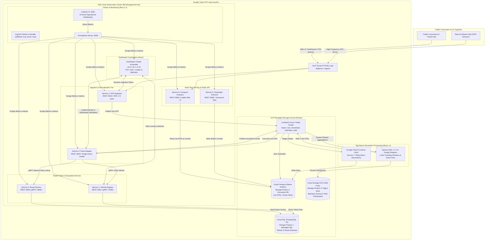

# S11 Public Transit Intelligence Platform — Cloud Migration & Integration Plan (`integrate.md`)
**Domain**: S11 Public Transportation — Real-Time Bus Arrival Estimates with ZooKeeper  
**Course**: CS/SS G527 Cloud Computing | BITS Pilani  
**Target Cloud Platform**: Google Cloud Platform (GCP) — Zero-Cost Architecture (Free-Tier & Student Credits)  
**Coordination Concept**: Apache ZooKeeper 3-Node Distributed Ensemble  

---

## 1. Cloud Target Architecture Overview

The system transitions from local development mode to a distributed, production-grade cloud-native architecture on Google Cloud Platform. 



---

## 2. Service Protocol & Network Matrix

| Service | Port (Container / Service) | Protocol | Ingress Exposure | Upstream / Downstream Dependencies |
|---|---|---|---|---|
| **Service 1: Vehicle Registry** | `8001` (REST) / `50051` (gRPC) | HTTP/1.1 & HTTP/2 (gRPC) | ClusterIP (Internal) | Cloud SQL PostgreSQL, ZooKeeper |
| **Service 2: GPS Ingestion** | `8002` (REST) | HTTP/1.1 | `/api/v1/telemetry` | Kafka (`bus-gps-raw`), ZooKeeper |
| **Service 3: Route Service** | `8003` (REST) / `50053` (gRPC) | HTTP/1.1 & HTTP/2 (gRPC) | ClusterIP (Internal) | Cloud SQL PostgreSQL |
| **Service 4: Event Adapter** | `8004` (REST) | HTTP/1.1 | ClusterIP (Internal) | ZooKeeper (Leader), Service 1 & 3 (gRPC), Kafka |
| **Service 5: Stream Processor** | Spark/Flink Driver | Native Streaming | Dataproc Internal | Kafka (`bus-gps-normalized`), GCS Checkpoints |
| **Service 6: Passenger Demand** | `8006` (REST) | HTTP/1.1 | ClusterIP (Internal) | Cloud Firestore NoSQL (`passenger_demand`) |
| **Service 7: Delay Alert Function** | Serverless Gen2 | HTTPS / PubSub / GCS | Cloud Functions Event | Cloud Firestore (`delay_alerts`), Kafka |
| **Service 8: Transport Analytics** | `8008` (REST & Web) | HTTP/1.1 | `/` (Public Ingress) | Cloud Firestore, Ingress, Commuter Browsers |
| **ZooKeeper 3-Node Ensemble** | `2181` (Client) / `2888:3888` | TCP Quorum | Headless Service | Service 1, Service 2, Service 4 |
| **Prometheus & Grafana** | `9090` (Prom) / `3000` (Grafana) | HTTP/1.1 | Port-Forward / Internal | Scrapes all microservices `/metrics` |

---

## 3. Step-by-Step Cloud Integration & Migration Plan

### Step 1: GCP Account & Project Bootstrap
Ensure your Google Cloud SDK is authenticated and configured to your active billing/student-credit project.

```bash
# 1. Login to Google Cloud
gcloud auth login
gcloud auth application-default login

# 2. Set your active project ID
export GCP_PROJECT_ID="your-project-id"
export GCP_REGION="asia-south1"
export GCP_ZONE="asia-south1-a"

gcloud config set project "${GCP_PROJECT_ID}"
gcloud config set compute/region "${GCP_REGION}"
gcloud config set compute/zone "${GCP_ZONE}"

# 3. Run automated project initialization script
chmod +x scripts/setup_gcp_project.sh
./scripts/setup_gcp_project.sh
```
*This script automatically enables `compute`, `container` (GKE), `sqladmin`, `firestore`, `storage`, `pubsub`, `cloudfunctions`, `run`, `artifactregistry`, `dataproc`, `monitoring`, and initializes Firestore in Native mode.*

---

### Step 2: Infrastructure Provisioning via Terraform (IaC)
Provision all VPC networks, GKE zonal cluster, Cloud SQL PostgreSQL, Cloud Storage buckets, and IAM bindings with 100% declarative Terraform.

```bash
cd terraform

# 1. Create your custom tfvars file
cp terraform.tfvars.example terraform.tfvars

# 2. Update terraform.tfvars with your GCP project ID
sed -i '' "s/your-gcp-project-id/${GCP_PROJECT_ID}/g" terraform.tfvars

# 3. Initialize Terraform plugins
terraform init

# 4. Preview execution plan
terraform plan

# 5. Apply infrastructure (Provisions GKE, Cloud SQL, Firestore, GCS)
terraform apply -auto-approve

# 6. Extract Terraform Outputs for Kubernetes wiring
export GKE_CLUSTER_NAME=$(terraform output -raw gke_cluster_name)
export CLOUD_SQL_IP=$(terraform output -raw cloud_sql_private_ip 2>/dev/null || terraform output -raw cloud_sql_public_ip)
export GCS_BUCKET=$(terraform output -raw gcs_bucket_name)

cd ..
```

---

### Step 3: Database & Cloud Storage Initialization

#### 3.1 Initialize Cloud SQL PostgreSQL
Connect to your Cloud SQL instance and execute the master DDL schema for Fleet Inventory and Route Geometry:

```bash
# Connect using gcloud SQL proxy or cloud client
gcloud sql connect transit-postgres-db --user=transit_admin --quiet < services/01-vehicle-registry/schema.sql
gcloud sql connect transit-postgres-db --user=transit_admin --quiet < services/03-route-service/schema.sql
```

#### 3.2 Initialize Cloud Storage Bucket Hierarchy
```bash
# Create dedicated folders for Flink checkpoints and telemetry archives
gcloud storage cp /dev/null "gs://${GCS_BUCKET}/flink-checkpoints/.keep"
gcloud storage cp /dev/null "gs://${GCS_BUCKET}/telemetry-archive/.keep"
gcloud storage cp /dev/null "gs://${GCS_BUCKET}/incidents/.keep"
```

---

### Step 4: Container Build & Push to Google Artifact Registry

Use the automated multi-service build script to package and push all microservices:

```bash
# Set permissions and build all 6 container images
chmod +x scripts/build_and_push_images.sh
./scripts/build_and_push_images.sh
```

To verify images in Artifact Registry:
```bash
gcloud artifacts docker images list "${GCP_REGION}-docker.pkg.dev/${GCP_PROJECT_ID}/transit-docker-repo"
```

---

### Step 5: Connect Kubernetes & Configure Cloud Secrets

Connect `kubectl` to your newly provisioned GKE cluster:

```bash
# Authenticate kubectl with GKE
gcloud container clusters get-credentials "${GKE_CLUSTER_NAME}" --zone "${GCP_ZONE}" --project "${GCP_PROJECT_ID}"

# Verify cluster connection
kubectl get nodes
```

#### 5.1 Update Global ConfigMap and Secrets
Update `k8s/base/configmaps.yaml` with your Cloud SQL IP and GCP Project ID:

```yaml
# Update in k8s/base/configmaps.yaml:
data:
  ZOOKEEPER_HOSTS: "zookeeper-service.transit-system.svc.cluster.local:2181"
  KAFKA_BOOTSTRAP_SERVERS: "kafka-service.transit-system.svc.cluster.local:9092"
  DATABASE_HOST: "<YOUR_CLOUD_SQL_IP>"
  DATABASE_PORT: "5432"
  DATABASE_NAME: "transit_db"
  GCP_PROJECT_ID: "<YOUR_GCP_PROJECT_ID>"
```

Update `k8s/base/secrets.yaml` with your database credentials:
```yaml
stringData:
  DATABASE_USER: "transit_admin"
  DATABASE_PASSWORD: "TransitSecurePass2026!"
  DATABASE_URL: "postgresql://transit_admin:TransitSecurePass2026!@<YOUR_CLOUD_SQL_IP>:5432/transit_db"
```

Apply initial configuration:
```bash
kubectl apply -f k8s/base/namespace.yaml
kubectl apply -f k8s/base/configmaps.yaml
kubectl apply -f k8s/base/secrets.yaml
```

---

### Step 6: Deploy Distributed Coordination (ZooKeeper Ensemble)

Deploy the 3-node fault-tolerant ZooKeeper statefulset backed by GKE Persistent Disk storage:

```bash
# 1. Deploy ZooKeeper Headless Service & StatefulSet
kubectl apply -f k8s/zookeeper/zookeeper-service.yaml
kubectl apply -f k8s/zookeeper/zookeeper-statefulset.yaml

# 2. Wait for all 3 nodes to attain Running state
kubectl rollout status statefulset/zookeeper -n transit-system --timeout=180s

# 3. Verify ZooKeeper 3-node Quorum (1 Leader, 2 Followers)
for i in 0 1 2; do
  echo "--- zk-$i Mode ---"
  kubectl exec -n transit-system zk-$i -- zkServer.sh status || true
done
```

---

### Step 7: Deploy Kafka Event Broker

Deploy Confluent Cloud credentials or in-cluster Kafka broker with the required transit topics:

```bash
# Create required event streaming topics
kubectl exec -n transit-system zk-0 -- /bin/bash -c "
  kafka-topics.sh --create --if-not-exists --bootstrap-server kafka-service:9092 --partitions 3 --replication-factor 2 --topic bus-gps-raw || true
  kafka-topics.sh --create --if-not-exists --bootstrap-server kafka-service:9092 --partitions 3 --replication-factor 2 --topic bus-gps-normalized || true
  kafka-topics.sh --create --if-not-exists --bootstrap-server kafka-service:9092 --partitions 3 --replication-factor 2 --topic bus-arrival-estimates || true
  kafka-topics.sh --create --if-not-exists --bootstrap-server kafka-service:9092 --partitions 1 --replication-factor 2 --topic bus-delay-alerts || true
"
```

---

### Step 8: Deploy Core Microservices (Kustomize / ArgoCD GitOps)

Deploy the application tier using Kustomize:

```bash
# Deploy all microservices, HPAs, and Ingress
kubectl apply -k k8s/production/

# Check pod deployment status
kubectl get pods -n transit-system -o wide
```

Verify service endpoints:
```bash
# Check REST and gRPC endpoints across all pods
kubectl get svc -n transit-system
```

---

### Step 9: Launch Flink Streaming on Dataproc & Serverless Function

#### 9.1 Apache Flink 1.17 on Dataproc (Requirement e)
Submit the PyFlink tumbling-window aggregation job:

```bash
cd services/05-stream-processor
chmod +x submit_dataproc_job.sh
./submit_dataproc_job.sh
cd ../..
```

#### 9.2 Serverless Delay Alert Cloud Function Gen2 (Requirement b)
Deploy Service 7 with Pub/Sub and Cloud Storage event triggers:

```bash
gcloud functions deploy transit-delay-alert \
    --gen2 \
    --runtime=python311 \
    --region="${GCP_REGION}" \
    --source=services/07-delay-alert-function \
    --entry-point=delay_alert_pubsub_handler \
    --trigger-topic=bus-delay-alerts \
    --set-env-vars=GCP_PROJECT_ID="${GCP_PROJECT_ID}" \
    --allow-unauthenticated
```

---

### Step 10: GitOps Continuous Delivery with ArgoCD (Requirement d)

Install and activate ArgoCD to enforce declarative drift detection:

```bash
# 1. Run ArgoCD installation script
chmod +x k8s/argocd/install-argocd.sh
./k8s/argocd/install-argocd.sh

# 2. Verify ArgoCD Root Application is Synced and Healthy
kubectl get application -n argocd
```

*Any manual attempt to edit pods with `kubectl edit` will immediately be corrected by ArgoCD's `selfHeal: true` policy.*

---

### Step 11: Observability & Telemetry Stack (Requirement h)

Deploy Prometheus, Grafana, and Loki log aggregator:

```bash
# Deploy monitoring stack
kubectl apply -f k8s/observability/prometheus-stack.yaml
kubectl apply -f k8s/observability/loki-stack.yaml
kubectl apply -f k8s/observability/grafana-dashboards.yaml

# Verify observability pods
kubectl get pods -n transit-system -l "tier in (monitoring, logging)"
```

To view Grafana in your local browser:
```bash
kubectl port-forward svc/grafana-service 3000:3000 -n transit-system
# Open http://localhost:3000 (User: admin, Pass: TransitAdmin2026!)
```
*The pre-configured dashboard includes 5 real-time panels: GPS Ingestion Rate, Stream Latency, Active Fleet Count, ZooKeeper Cluster State, and Container Memory/CPU.*

---

### Step 12: External Access & End-to-End Live Verification

```bash
# 1. Obtain public Ingress IP
kubectl get ingress transit-public-ingress -n transit-system

# Export the public IP
export INGRESS_IP=$(kubectl get ingress transit-public-ingress -n transit-system -o jsonpath='{.status.loadBalancer.ingress[0].ip}')
echo "Public Web Dashboard: http://${INGRESS_IP}/"
```

#### 12.1 Live GPS Telemetry Burst Test
```bash
# Send burst of GPS telemetry to Service 2 via Public Load Balancer
python3 services/02-gps-ingestion/main.py --burst=100 --host="http://${INGRESS_IP}"
```

#### 12.2 Live Delay Broadcast Test
```bash
# Trigger an 8.5m delay on BUS-101
curl -X POST "http://${INGRESS_IP}/api/v1/analytics/trigger-delay" \
  -H "Content-Type: application/json" \
  -d '{"bus_id": "BUS-101", "delay_minutes": 8.5, "reason": "Cloud Load Bottleneck"}'
```
*Verify on `http://${INGRESS_IP}/` that BUS-101 immediately displays `10 mins` in red with `DELAYED (+8.5m)`.*

#### 12.3 ZooKeeper Active-Standby Failover Test
```bash
# Run automated ZooKeeper leader kill test
python3 scripts/demo_zookeeper_failover.py
```

---

## 4. Cost Guardrails & 1-Command Teardown

To ensure total expenditure remains at **₹0 (Zero Cost)** under Free-Tier and Student Credits:

```bash
# 1. Audit active cloud compute resources
./scripts/cost_guardrail.sh

# 2. When demo/testing concludes, tear down all active cloud resources in 1 command:
cd terraform && terraform destroy -auto-approve
```

---

## 5. Summary Checklist for Viva & Evaluation

- [x] **Requirement a (Microservices Architecture)**: 8 distinct, decoupled services covering ingestion, master data, streaming, demand, serverless alerts, and analytics.
- [x] **Requirement b (Serverless Processing)**: Google Cloud Functions Gen2 evaluating delay incidents.
- [x] **Requirement c (Three Storage Products)**: Cloud SQL (PostgreSQL), Cloud Firestore (NoSQL), Cloud Storage (GCS).
- [x] **Requirement d (GitOps Continuous Delivery)**: ArgoCD with automated reconciliation (`selfHeal: true`, `prune: true`).
- [x] **Requirement e (Big Data / Stream Processing)**: Apache Flink 1-minute tumbling windows on Dataproc.
- [x] **Requirement f (Distributed Concept — ZooKeeper)**: 3-Node ZooKeeper ensemble with leader election, watchers, and ephemeral registry.
- [x] **Requirement g (Zero-Cost / Free-Tier Optimization)**: Zonal GKE ($0 fee), Cloud SQL micro, Firestore Always-Free tier.
- [x] **Requirement h (Observability & Monitoring)**: Prometheus, Grafana 5-panel dashboard, and Loki log collector.
