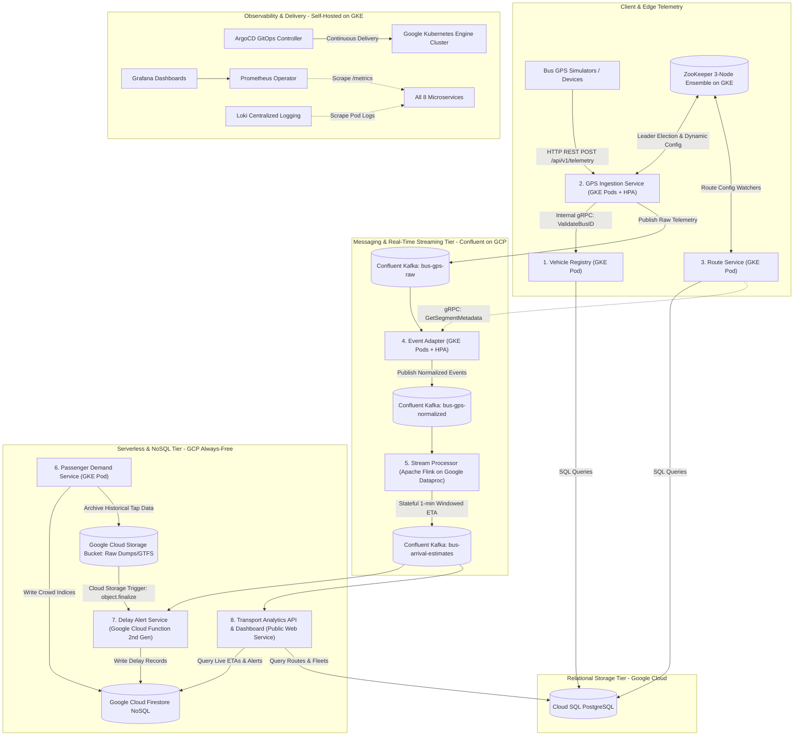

# S11: Real-Time Public Transportation Bus Arrival Estimation & Tracking System
## CS/SS G527 - Cloud Computing Assignment (BITS Pilani)
### Distributed Systems & Cloud Architecture Implementation Plan
### 🇬 Google Cloud Platform (GCP) Zero-Cost & Free-Tier Master Edition

---

## 1. Executive Summary & Assignment Specifications

- **Project Code & Domain**: `S11` — Public Transportation: Real-Time Bus Arrival Estimates
- **Mandatory Distributed System Concept**: **ZooKeeper System** (Leader Election, Distributed Locks, Dynamic Configuration, and Health Heartbeating)
- **Course**: CS/SS G527 Cloud Computing, I Semester 2025–2026, BITS Pilani
- **Evaluation Weightage**: 60 Marks (15% overall grade) — includes 12M reserved for individual contribution/demonstration
- **Budget Goal**: **₹0.00 (Zero Out-of-Pocket Expense)** utilizing Google Cloud Free Tier, $300 Free Trial Credits, and Always-Free Student Perks.
- **Primary Cloud Provider**: **Google Cloud Platform (GCP)** (fully satisfying all assignment requirements a–h)
- **GCP Technology Stack**:
  - **IaC**: Terraform (`hashicorp/google` and `hashicorp/google-beta` providers)
  - **Managed Kubernetes (Req c)**: **Google Kubernetes Engine (GKE)** — 1 Zonal Cluster has **$0.00/month** cluster management fee (Free Tier)
  - **GitOps Controller (Req d)**: ArgoCD (Open-source, self-hosted on GKE)
  - **Real-Time Stream Processing (Req e)**: **Apache Flink on Google Cloud Dataproc** (explicitly cited in assignment sheet; covered by $300 credit)
  - **Managed Event Broker (Req e)**: **Confluent Cloud on GCP** ($400 free trial credits, explicitly cited in PDF) or **Strimzi Kafka on GKE**
  - **Serverless Function (Req b)**: **Google Cloud Functions (2nd Gen)** (Always-Free Tier: **2 Million invocations/month free forever**)
  - **Distributed Consensus (Req f)**: **Apache ZooKeeper** (3-node ensemble deployed on GKE)
  - **3 Distinct Storage Products on GCP (Req g)**:
    1. *Object Store*: **Google Cloud Storage (GCS)** (Always-Free Tier: 5 GB-months in US regions)
    2. *Managed Relational SQL*: **Cloud SQL for PostgreSQL** (Lightweight `db-f1-micro` / `db-g1-small` covered by $300 credit)
    3. *Managed NoSQL*: **Google Cloud Firestore** (Always-Free Tier: 1 GiB storage, 50,000 reads/day, 20,000 writes/day free forever)
  - **Observability Stack (Req h)**: Prometheus + Grafana + Loki (Self-hosted on GKE) + Google Cloud Logging (50 GiB/month free)
  - **Public Web Service**: Service 8 (Transport Analytics API & Live Dashboard) exposed via GKE Ingress / External Load Balancer

---

## 2. 🇬 Google Cloud Zero-Cost & Free-Tier Blueprint

Google Cloud is the most generous and cost-effective cloud provider for student projects. By combining Google's **Always-Free Tiers** with the **$300 Free Trial Credit**, your total out-of-pocket cost is **₹0.00**.

```
========================================================================================
GOOGLE CLOUD ZERO-COST AUDIT & SAVINGS MATRIX
========================================================================================
1. GKE Cluster Management:
   - Pricing: Google waives the $0.10/hour cluster fee for 1 Zonal Cluster per billing account.
   - Cost: $0.00/month (Saves $73.00/month compared to AWS EKS).

2. Google Cloud Functions (2nd Gen) — Serverless Delay Alert Service:
   - Pricing: 2,000,000 invocations/month free, 400,000 GB-seconds free.
   - Cost: $0.00/month (Always Free).

3. Google Cloud Storage (GCS) — Raw Telemetry & GTFS Dumps:
   - Pricing: 5 GB-months of standard storage free per month.
   - Cost: $0.00/month (Always Free).

4. Google Cloud Firestore — Real-Time Bus ETAs & Passenger Demand:
   - Pricing: 1 GiB storage, 50,000 reads/day, 20,000 writes/day, 20,000 deletes/day free.
   - Cost: $0.00/month (Always Free).

5. Cloud SQL PostgreSQL & Dataproc (Flink):
   - Pricing: Covered 100% by the $300 Google Cloud Free Trial Credit.
   - Cost: ₹0.00 out of pocket.

6. Confluent Cloud on GCP (Managed Kafka):
   - Pricing: $400 Free Trial Credit for Apache Kafka (No upfront commitment).
   - Cost: $0.00 (Explicitly allowed by assignment sheet).

7. Self-Hosted Tools on GKE (ZooKeeper, ArgoCD, Prometheus, Grafana, Loki):
   - Cost: $0.00 (Runs inside your existing GKE worker node pool).

TOTAL ESTIMATED OUT-OF-POCKET EXPENSE: ₹0.00
========================================================================================
```

---

## 3. High-Level Architectural Flowchart (Google Cloud)



---

## 4. Team Task Division Matrix (4 Members, 2 Tasks & 2 Services Each)

As mandated by BITS Pilani guidelines (2 tasks from a–h and 2 microservices per member for 12M individual contribution):

```
========================================================================================
TASK DIVISION SUMMARY (task_division.txt)
========================================================================================
Member 1:
  - Tasks: Task (a) Infrastructure as Code (Terraform on GCP) & Task (b) Serverless (Cloud Functions) & Cloud Comms
  - Microservices: Service 1 (Vehicle Registry) & Service 2 (GPS Ingestion Service)
  - Ownership: GCP VPC setup, Cloud SQL/GCS Terraform, gRPC proto definitions, REST telemetry ingestion.

Member 2:
  - Tasks: Task (c) Managed K8s (GKE), Autoscaling & Load Testing & Task (d) GitOps Pipeline (ArgoCD)
  - Microservices: Service 3 (Route Service) & Service 4 (Event Adapter)
  - Ownership: GKE cluster provisioning, ArgoCD deployment & Git sync, HPA scaling, k6 load testing scripts.

Member 3:
  - Tasks: Task (e) Real-Time Stream Processing (Flink on Dataproc) & Task (f) ZooKeeper Distributed Concept
  - Microservices: Service 5 (Stream Processor - Flink) & Service 6 (Passenger Demand Service)
  - Ownership: Dataproc Flink cluster, event-time watermarking, ZooKeeper ensemble & leader election.

Member 4:
  - Tasks: Task (g) 3 Cloud Storage Products (GCS, Cloud SQL, Firestore) & Task (h) Observability & Public Web
  - Microservices: Service 7 (Delay Alert Service - Cloud Function) & Service 8 (Transport Analytics API)
  - Ownership: GCS/Cloud SQL/Firestore schemas, Prometheus/Grafana/Loki stack, public web dashboard.
========================================================================================
```

---

## 5. Detailed 8-Part Implementation Roadmap

```mermaid
graph LR
    P1[Part 1: GCP IaC & 3 Storage Tiers] --> P2[Part 2: Relational Services & gRPC]
    P2 --> P3[Part 3: ZooKeeper Distributed Coordination]
    P3 --> P4[Part 4: GPS Ingestion, Adapter & Kafka]
    P4 --> P5[Part 5: Flink Stream Processing on Dataproc]
    P5 --> P6[Part 6: Cloud Functions & Firestore Demand]
    P6 --> P7[Part 7: GitOps & GKE Autoscaling]
    P7 --> P8[Part 8: Public API, Observability & Package]
```



---

### PART 1: Google Cloud Infrastructure as Code (IaC) & Storage Foundation
> **Focus**: Assignment Requirements **(a)** and **(g)**  
> **Key Objective**: Provision all foundational cloud infrastructure exclusively using Terraform with the `google` provider, staying strictly inside free-tier and credit limits.

#### 1.1 Directory Structure
```
terraform/
├── main.tf
├── variables.tf
├── outputs.tf
├── terraform.tfvars
└── modules/
    ├── vpc/             # Google Compute Network, Custom Subnet, Firewall Rules
    ├── gke/             # Zonal GKE Cluster ($0 management fee), e2-medium Node Pool
    ├── cloud_sql/       # Cloud SQL for PostgreSQL (db-f1-micro)
    ├── firestore/       # Google Cloud Firestore Database (Always Free)
    ├── gcs/             # Google Cloud Storage Bucket (5 GB Free Tier)
    └── confluent/       # Confluent Cloud Kafka Topic Provisioning ($400 Free Trial)
```

#### 1.2 Zero-Cost Terraform Definitions
1. **GCP VPC & Subnets (`modules/vpc/main.tf`)**:
   - Custom VPC with private Google access enabled (allows GKE pods to reach Cloud SQL and GCS without public IP transit).
   - Firewall rules allowing internal gRPC/REST communication and Prometheus scraping.
2. **Managed Kubernetes (`modules/gke/main.tf`)**:
   - **GKE Zonal Cluster** in `us-central1-a` (qualifies for the **$0.00 cluster management fee**).
   - Node pool: 2 to 3 `e2-medium` nodes with preemptible/spot option enabled to minimize credit consumption.
3. **Storage Product 1 — Managed SQL (`modules/cloud_sql/main.tf`)**:
   - PostgreSQL 15 on `db-f1-micro` tier (shared CPU, 0.6 GB RAM).
   - Databases: `transit_registry` (Vehicle Registry & Route Service tables).
4. **Storage Product 2 — Managed NoSQL (`modules/firestore/main.tf`)**:
   - Google Cloud Firestore in Native mode (`(default)` database).
   - Collections: `realtime_estimates`, `passenger_demand`, `delay_alerts`.
   - **Always Free**: 1 GiB storage, 50,000 reads/day.
5. **Storage Product 3 — Object Store (`modules/gcs/main.tf`)**:
   - GCS Bucket: `gs://transit-telemetry-raw-archive-<project_id>` in `us-central1` (5 GB free tier).
   - Configured with Google Cloud Eventarc / Pub/Sub notifications for serverless triggers.
6. **Managed Kafka (`modules/confluent/main.tf`)**:
   - Standard Confluent Cloud Kafka cluster provisioned in `us-central1` (same region as GKE).
   - Topics: `bus-gps-raw`, `bus-gps-normalized`, `bus-arrival-estimates`, `bus-delay-alerts`.

#### 1.3 Step-by-Step Execution & Verification
- [ ] Authenticate Google Cloud SDK: `gcloud auth login` and `gcloud auth application-default login`.
- [ ] Set current GCP Project: `gcloud config set project <PROJECT_ID>`.
- [ ] Initialize Terraform: `terraform init`.
- [ ] Plan resources: `terraform plan -out=tfplan`.
- [ ] Apply: `terraform apply tfplan`.
- [ ] Verify: Test connection to GKE via `gcloud container clusters get-credentials ...`.

---

### PART 2: Core Relational Microservices & High-Speed gRPC/REST Communication
> **Focus**: **Service 1 (Vehicle Registry)**, **Service 3 (Route Service)**, and Requirement **(b)** (REST & gRPC communication)  
> **Key Objective**: Establish master data services on Cloud SQL PostgreSQL with an inter-service gRPC contract.

#### 2.1 Microservice 1: Vehicle Registry
- **Role**: Authoritative inventory of transit fleet, capacity, fuel/battery type, and active route assignments.
- **Data Model (Cloud SQL PostgreSQL)**:
  ```sql
  CREATE TABLE vehicles (
      bus_id VARCHAR(50) PRIMARY KEY,
      license_plate VARCHAR(20) NOT NULL UNIQUE,
      model VARCHAR(50),
      capacity INT NOT NULL,
      status VARCHAR(20) DEFAULT 'ACTIVE', -- ACTIVE, MAINTENANCE, RETIRED
      assigned_route_id VARCHAR(50),
      created_at TIMESTAMP WITH TIME ZONE DEFAULT CURRENT_TIMESTAMP
  );
  ```
- **Interfaces**:
  - **REST API**: `GET /api/v1/vehicles`, `POST /api/v1/vehicles`, `GET /api/v1/vehicles/{id}`
  - **gRPC Server**: High-speed RPC `ValidateVehicle(VehicleRequest) returns (VehicleResponse)` serving internal lookups in under 5ms.

#### 2.2 Microservice 3: Route Service
- **Role**: Transit route geometry, stop sequences, geofences, and segment matrices.
- **Data Model (Cloud SQL PostgreSQL)**:
  ```sql
  CREATE TABLE routes (
      route_id VARCHAR(50) PRIMARY KEY,
      route_name VARCHAR(100) NOT NULL,
      start_terminal VARCHAR(100),
      end_terminal VARCHAR(100),
      total_distance_km NUMERIC(5,2)
  );

  CREATE TABLE stops (
      stop_id VARCHAR(50) PRIMARY KEY,
      stop_name VARCHAR(100) NOT NULL,
      latitude DOUBLE PRECISION NOT NULL,
      longitude DOUBLE PRECISION NOT NULL,
      geofence_radius_meters INT DEFAULT 50
  );

  CREATE TABLE route_stops (
      route_id VARCHAR(50) REFERENCES routes(route_id),
      stop_id VARCHAR(50) REFERENCES stops(stop_id),
      stop_sequence INT NOT NULL,
      expected_time_from_prev_sec INT,
      distance_from_prev_meters INT,
      PRIMARY KEY (route_id, stop_sequence)
  );
  ```
- **Interfaces**:
  - **REST API**: `GET /api/v1/routes`, `GET /api/v1/routes/{id}/stops`
  - **gRPC Server**: `GetRouteDetails(RouteRequest) returns (RouteDetailsResponse)`

#### 2.3 gRPC Protocol Buffers Contract (`proto/transit.proto`)
```protobuf
syntax = "proto3";
package transit;

service VehicleRegistryService {
  rpc ValidateVehicle (VehicleRequest) returns (VehicleResponse);
}

message VehicleRequest {
  string bus_id = 1;
}

message VehicleResponse {
  bool is_valid = 1;
  string status = 2;
  string assigned_route_id = 3;
}

service RouteGeometryService {
  rpc GetRouteDetails (RouteRequest) returns (RouteDetailsResponse);
}

message RouteRequest {
  string route_id = 1;
}

message StopInfo {
  string stop_id = 1;
  int32 sequence = 2;
  double latitude = 3;
  double longitude = 4;
}

message RouteDetailsResponse {
  string route_id = 1;
  repeated StopInfo stops = 2;
}
```

#### 2.4 Step-by-Step Execution & Verification
- [ ] Generate Python/Go gRPC stubs: `python -m grpc_tools.protoc ...`.
- [ ] Implement database connection pooling for Cloud SQL.
- [ ] Build and push container images to Google Artifact Registry (`pkg.dev/...`).
- [ ] Execute test gRPC call between local container and service on GKE; verify latency < 5ms.

---

### PART 3: Distributed Coordination & Leader Election with ZooKeeper
> **Focus**: Assignment Requirement **(f)** (Domain Concept: ZooKeeper System)  
> **Key Objective**: Deploy ZooKeeper on GKE and implement Active-Standby Leader Election for the Ingestion Coordinator and Dynamic Configuration Watchers.

#### 3.1 Why ZooKeeper in Real-Time Transit Systems?
1. **Active-Standby Leader Election**: Multiple instances of the GPS Ingestion Coordinator run concurrently. Only the elected Leader coordinates partition assignments, rate-limit thresholds, and telemetry health; standby replicas take over instantaneously if the leader fails.
2. **Dynamic Configuration & Route Cache Invalidation**: When route detours, emergency stop closures, or speed limits change in Route Service, ZooKeeper **Watches** trigger atomic, zero-downtime cache invalidation across all ingestion and processing nodes.
3. **Node Health & Ephemeral Membership**: Edge GPS ingest gateways register ephemeral znodes (`/transit/gateways/node-xxx`). If a gateway crashes or loses network connectivity, its znode automatically vanishes, alerting the coordinator.

#### 3.2 ZooKeeper Znode Hierarchy
```
/transit
├── election/
│   ├── leader-0000000001 (Ephemeral Sequential: Active Leader)
│   ├── leader-0000000002 (Ephemeral Sequential: Standby 1)
│   └── leader-0000000003 (Ephemeral Sequential: Standby 2)
├── config/
│   ├── active-routes     (Persistent: JSON metadata of active routes)
│   └── rate-limits       (Persistent: Max pings/sec per vehicle)
└── live-gateways/
    ├── gw-pod-1          (Ephemeral: Heartbeat node)
    └── gw-pod-2          (Ephemeral: Heartbeat node)
```

#### 3.3 Implementation Details
- **Cluster Deployment**: ZooKeeper 3-node ensemble deployed via Helm or K8s StatefulSet on GKE.
- **Python Client Integration (`kazoo` library)**:
  - **Leader Election Algorithm**:
    1. Worker creates an ephemeral sequential node: `/transit/election/guid-n_`
    2. Retrieves all children under `/transit/election`.
    3. If its sequence number is the smallest, it becomes the **ACTIVE LEADER**.
    4. Otherwise, it sets a **Watcher** on the node with the next smaller sequence number.
    5. On leader crash/deletion, the next node receives the notification and promotes itself to Leader.
  - **Dynamic Configuration Watcher**:
    - Microservices register a `DataWatch` on `/transit/config/active-routes`.
    - Updates to the znode immediately broadcast to all pods without container restarts.

#### 3.4 Step-by-Step Execution & Verification
- [ ] Deploy ZooKeeper StatefulSet (`zk-0`, `zk-1`, `zk-2`) on GKE.
- [ ] Embed ZooKeeper Leader Election logic into GPS Ingestion Coordinator.
- [ ] Embed ZooKeeper DataWatch into Route Service & Ingestion Service.
- [ ] **Failover Demonstration Test**:
  - Launch 3 replicas of the Ingestion Coordinator.
  - Observe Leader election via logs.
  - Terminate the leader pod (`kubectl delete pod <leader-pod>`).
  - Demonstrate failover to standby in < 2 seconds with automatic znode cleanup.
  - Update `/transit/config/active-routes` and verify watcher trigger logged across all active pods.

---

### PART 4: Telemetry Ingestion, Event Adaptation & Kafka Message Queue
> **Focus**: **Service 2 (GPS Ingestion Service)**, **Service 4 (Event Adapter)**, and Requirement **(b)** (Message Queues)  
> **Key Objective**: Build the streaming ingestion pipeline connecting GKE microservices to Confluent Cloud Kafka.

#### 4.1 Microservice 2: GPS Ingestion Service
- **Role**: High-throughput REST entrypoint accepting real-time telemetry from GPS-equipped transit buses.
- **Processing Logic**:
  1. Receives HTTP POST JSON telemetry payload:
     ```json
     {
       "bus_id": "BUS-ROUTE101-042",
       "latitude": 28.3638,
       "longitude": 75.5872,
       "speed_kmh": 34.5,
       "heading": 182.0,
       "timestamp": "2026-11-18T01:30:00Z"
     }
     ```
  2. Calls **Vehicle Registry** via **gRPC** (`ValidateVehicle`) to verify `bus_id` is registered and active.
  3. Checks ZooKeeper active leader state and dynamic rate limits.
  4. Publishes validated telemetry asynchronously to Kafka topic `bus-gps-raw` (Partition Key: `bus_id`).
  5. Returns HTTP `202 Accepted` with correlation ID.

#### 4.2 Microservice 4: Event Adapter
- **Role**: Normalizes incoming unstructured/raw telemetry, calculates geospatial deltas, enriches with stop sequence metadata, and prepares clean event streams for stream processing.
- **Processing Logic**:
  1. Consumes from Kafka `bus-gps-raw`.
  2. Queries **Route Service** (or local synchronized cache) for route stop geofences.
  3. Attaches unique UUID `event_id`, computes distance to next scheduled stop, and formats timestamp to ISO-8601 UTC.
  4. Normalized Event Schema published to Kafka topic `bus-gps-normalized`:
     ```json
     {
       "event_id": "c7a8b9e0-1234-4567-89ab-cdef01234567",
       "bus_id": "BUS-ROUTE101-042",
       "route_id": "ROUTE-101",
       "latitude": 28.3638,
       "longitude": 75.5872,
       "speed_kmh": 34.5,
       "heading": 182.0,
       "next_stop_id": "STOP-BITS-MAIN-GATE",
       "distance_to_next_stop_meters": 450,
       "event_timestamp": 1794965400000,
       "ingest_timestamp": 1794965400120
     }
     ```

#### 4.3 Kafka Topic Configuration (Confluent Cloud on GCP)
- `bus-gps-raw`: 6 Partitions, Replication Factor 3.
- `bus-gps-normalized`: 6 Partitions, Replication Factor 3.
- `bus-arrival-estimates`: 6 Partitions, Replication Factor 3.
- `bus-delay-alerts`: 3 Partitions, Replication Factor 3.

#### 4.4 Step-by-Step Execution & Verification
- [ ] Implement Service 2 (FastAPI/Go) with gRPC client and Kafka producer.
- [ ] Implement Service 4 (Python/Go) with Kafka consumer and producer.
- [ ] Verify end-to-end flow: `HTTP POST -> gRPC Validation -> Kafka raw -> Adapter -> Kafka normalized`.

---

### PART 5: Stateful Real-Time Stream Processing with Apache Flink on Google Dataproc
> **Focus**: **Service 5 (Stream Processor)** and Assignment Requirement **(e)**  
> **Key Objective**: Deploy Apache Flink on a managed Google Cloud Dataproc cluster to execute stateful, event-time windowed aggregations, handle late-arriving events with watermarks, and compute dynamic arrival times (ETAs).

#### 5.1 Google Cloud Dataproc Flink Cluster Setup
- **Cluster Deployment**:
  - Provisioned via Terraform (`google_dataproc_cluster`) with the **Flink component** enabled:
    ```hcl
    software_config {
      optional_components = ["FLINK"]
    }
    ```
  - Master node: 1 `e2-standard-2`, Worker nodes: 2 `e2-standard-2` (covered by $300 credit).
- **State Backend**: RocksDB StateBackend with periodic checkpointing to Google Cloud Storage (`gs://transit-telemetry-raw-archive/flink-checkpoints/`).

#### 5.2 Stream Processing Algorithm & Windowing
1. **Source**: Flink Kafka Consumer reading `bus-gps-normalized`.
2. **Event-Time & Watermarking**:
   - Uses `WatermarkStrategy.forBoundedOutOfOrderness(Duration.ofSeconds(20))` to tolerate out-of-order and delayed mobile GPS transmissions.
   - Timestamp extractor: `event_timestamp`.
3. **Keyed Streams**:
   - Stream keyed by `route_id` and `bus_id`.
4. **Stateful Window Aggregation (1-Minute Tumbling/Sliding Window)**:
   - Maintains `ValueState<BusTravelState>`: Tracks previous location, historical segment transit speeds, and cumulative stop arrivals.
   - Calculates:
     - Rolling average speed over window.
     - Predicted Arrival Time (ETA) at upcoming 3 stops:
       $$\text{ETA}_{\text{stop}} = \text{WindowTimestamp} + \frac{\text{Distance to Stop}}{\text{Rolling Avg Speed}} + \text{Dwell Time}$$
     - Delay calculation: $\Delta = \text{ETA}_{\text{predicted}} - \text{ETA}_{\text{scheduled}}$.
5. **Late Event Handling**:
   - Events arriving after the 20-second watermark boundary are diverted to a **Side Output** (`late-gps-events`) to prevent state corruption, then archived to GCS.
6. **Sink**:
   - Flink Kafka Producer publishing aggregated estimates to `bus-arrival-estimates` topic.
   - Emits route-level statistics (average velocity, congestion factor) to `bus-route-stats`.

#### 5.3 Output Schema (`bus-arrival-estimates`)
```json
{
  "calculation_window_end": "2026-11-18T01:31:00Z",
  "bus_id": "BUS-ROUTE101-042",
  "route_id": "ROUTE-101",
  "current_segment_speed_kmh": 32.1,
  "next_stop_id": "STOP-BITS-MAIN-GATE",
  "estimated_arrival_time": "2026-11-18T01:34:15Z",
  "eta_seconds": 195,
  "scheduled_arrival_time": "2026-11-18T01:32:00Z",
  "delay_seconds": 135,
  "status": "DELAYED"
}
```

#### 5.4 Step-by-Step Execution & Verification
- [ ] Build PyFlink or Java Flink application jar.
- [ ] Submit job to Google Cloud Dataproc:
  `gcloud dataproc jobs submit flink --cluster=transit-flink-cluster --jar=transit-stream-processor.jar ...`
- [ ] Replay test GPS data containing out-of-order events.
- [ ] Verify that:
  1. Watermarks advance properly.
  2. 1-minute windowed aggregations produce accurate ETAs.
  3. Late events are routed to side output without crashing the job.
  4. Aggregated messages land in `bus-arrival-estimates` Kafka topic.

---

### PART 6: Serverless Event-Driven Delay Alerts & NoSQL Passenger Demand Service
> **Focus**: **Service 6 (Passenger Demand Service)**, **Service 7 (Delay Alert Service - Serverless)**, Requirement **(b)**, and Requirement **(g)**  
> **Key Objective**: Implement the serverless event-driven microservice using Google Cloud Functions and NoSQL high-throughput analytics on Firestore within Always-Free Tiers.

#### 6.1 Microservice 7: Delay Alert Service (Google Cloud Function 2nd Gen — Req b)
- **Runtime**: Python 3.11 on Google Cloud Functions (2nd Gen / Cloud Run functions).
- **Cost**: **$0.00** (Always-Free Tier allows up to 2,000,000 invocations/month).
- **Trigger**: Asynchronous Event-Driven invocation via:
  1. **Kafka Event Trigger / Pub/Sub**: Consumes from `bus-arrival-estimates` where `delay_seconds > 300` (5 minutes).
  2. **GCS Object Finalize Notification**: Triggered when a new transit incident/roadblock report file is uploaded to `gs://transit-telemetry-raw-archive/incidents/`.
- **Execution Logic**:
  1. Evaluates disruption threshold: Minor (5–10 min), Major (10–25 min), Critical (> 25 min).
  2. Generates unique alert record:
     ```json
     {
       "alert_id": "ALT-20261118-0912",
       "bus_id": "BUS-ROUTE101-042",
       "route_id": "ROUTE-101",
       "stop_id": "STOP-BITS-MAIN-GATE",
       "delay_minutes": 7.5,
       "severity": "MODERATE",
       "timestamp": "2026-11-18T01:31:05Z",
       "message": "Bus BUS-ROUTE101-042 delayed by 7.5 min approaching BITS Main Gate due to traffic congestion."
     }
     ```
  3. Writes alert record into **Google Cloud Firestore** collection `delay_alerts`.
  4. Dispatches webhook notification to external subscriber endpoints / SMS simulator.

#### 6.2 Microservice 6: Passenger Demand Service
- **Role**: Ingests smartcard/automated passenger counter (APC) sensor data and estimates stop-level passenger density and waiting crowds.
- **Storage**:
  - **NoSQL (Firestore)**: Collection `passenger_demand` stores real-time stop crowd status with fast lookups.
  - **Object Store (GCS)**: Batches of raw tap logs stored as compressed Parquet files for long-term historical analytics.
- **Interfaces**:
  - `POST /api/v1/demand/tap`: Records passenger boarding/alighting.
  - `GET /api/v1/demand/stops/{stop_id}`: Returns real-time congestion index (e.g. LOW, MEDIUM, HIGH, SURGE).

#### 6.3 Step-by-Step Execution & Verification
- [ ] Deploy Cloud Function via Terraform or `gcloud functions deploy delay-alert-service ...`.
- [ ] Implement Service 6 with Google Cloud Firestore SDK.
- [ ] Test Serverless execution: Publish a simulated ETA with 8-minute delay; verify Cloud Function executes asynchronously, logs to Cloud Logging, and writes alert into Firestore.
- [ ] Upload an incident file to GCS and verify automatic Cloud Function trigger execution.

---

### PART 7: GitOps Continuous Delivery & Kubernetes Autoscaling with Load Testing
> **Focus**: Assignment Requirements **(c)** and **(d)**  
> **Key Objective**: Implement zero-manual-kubectl GitOps continuous deployment with ArgoCD and validate HPA scaling on GKE under sustained synthetic load.

#### 7.1 GitOps Pipeline Setup (ArgoCD — Req d)
- **Rule**: Direct `kubectl apply` is strictly forbidden for application deployments.
- **Setup**:
  1. Install ArgoCD on the GKE cluster inside `argocd` namespace.
  2. Create a dedicated Git repository (`transit-gitops-manifests`) containing all declarative K8s manifests:
     ```
     k8s/
     ├── base/
     │   ├── vehicle-registry/
     │   ├── gps-ingestion/
     │   ├── route-service/
     │   ├── event-adapter/
     │   ├── passenger-demand/
     │   └── transport-analytics/
     ├── environments/
     │   └── production/
     │       ├── kustomization.yaml
     │       ├── ingress.yaml
     │       └── hpa.yaml
     └── argocd/
         └── application-root.yaml
     ```
  3. Configure ArgoCD Application with Automated Sync Policy, Self-Heal, and Prune.
  4. Verify that any commit pushed to the Git repo is automatically detected and deployed within 60 seconds by ArgoCD.

#### 7.2 Horizontal Pod Autoscalers (HPA — Req c)
Deploy HPAs for at least **two critical microservices**:
1. **Critical Service 1: GPS Ingestion Service**:
   - `minReplicas`: 2, `maxReplicas`: 8
   - Metric: CPU Utilization Target 50%
2. **Critical Service 2: Event Adapter**:
   - `minReplicas`: 2, `maxReplicas`: 6
   - Metric: Memory Utilization Target 60% (or CPU 50%)

#### 7.3 Sustained Load Testing Suite (k6 / JMeter — Req c)
Create a comprehensive `load-test.js` script with **k6**:
- **Ramp-Up**: 0 to 300 Virtual Users (VUs) over 1 minute.
- **Sustained Traffic**: 300 to 800 VUs generating 1,500+ requests/sec for 4 minutes.
- **Cool-Down**: Ramp down to 0 VUs over 1 minute.
- **Verification Criteria**:
  - Watch HPA replica count increase: `kubectl get hpa -w`
  - Demonstrate GPS Ingestion pods scaling out from 2 replicas to 6–8 replicas in real time.
  - Pods scale in smoothly after traffic subsides.
  - Zero dropped requests (HTTP 200/202 success rate > 99.5%).

---

### PART 8: Public Analytics Web Dashboard, End-to-End Observability & Deliverables Packaging
> **Focus**: **Service 8 (Transport Analytics API)**, Requirement **(h)**, Public URL, and Final Deliverables  
> **Key Objective**: Expose the public web portal, deploy the complete Prometheus/Grafana/Loki observability stack, and package all deliverables for evaluation.

#### 8.1 Microservice 8: Transport Analytics API & Public Web Dashboard
- **Role**: Serves consolidated real-time transit intelligence to commuters and operators.
- **Public URL**: Exposed via GKE Ingress / Google Cloud External HTTP(S) Load Balancer IP.
- **Features**:
  1. **REST Endpoints**:
     - `GET /api/v1/analytics/arrivals/{stop_id}`: Real-time upcoming arrivals with live ETAs.
     - `GET /api/v1/analytics/delays`: Active delay alerts with severity.
     - `GET /api/v1/analytics/fleet-stats`: Active buses, average route velocities, and system health.
  2. **Interactive Web Dashboard**:
     - Visual map (Leaflet / MapLibre) plotting real-time bus locations, route paths, and stop arrival countdown boards.
     - Auto-refreshes every 5 seconds.

#### 8.2 Comprehensive Observability Stack (Req h)
1. **Metrics Collection (Prometheus)**:
   - Prometheus Operator deployed via Helm on GKE.
   - ServiceMonitors targeting all 8 microservices exposing `/metrics`.
   - Kubernetes cluster health exporter (`kube-state-metrics`, `node-exporter`).
2. **Visualization (Grafana)**:
   - **Dashboard 1: Transit Microservices Health**:
     - Request Rate (RPS) per service.
     - P95 and P99 Latency percentiles.
     - HTTP 4xx / 5xx Error Rates.
     - Kafka Topic lag and ingestion throughput.
   - **Dashboard 2: Kubernetes Cluster & HPA Health**:
     - CPU & Memory utilization per node and pod.
     - Live HPA replica count vs. target utilization during load tests.
3. **Centralized Logging (Grafana Loki & Promtail + Cloud Logging)**:
   - Promtail daemonset scrapes `/var/log/pods` across all nodes.
   - Ingests structured JSON logs from all 8 microservices and the Flink job into Loki.
   - Google Cloud Logging integration (50 GiB/month free tier).

#### 8.3 Deliverables Compilation & Packaging
1. **Design Document (`DESIGN_DOCUMENT.md` / PDF)**:
   - System overview & domain problem formulation.
   - Cloud deployment architecture diagram (Google Cloud).
   - Microservices architecture diagrams and inter-service communication matrix.
   - Rationale for cloud design choices (Serverless choice, NoSQL vs SQL separation, ZooKeeper role, Flink vs Spark).
2. **Source Code & GitOps Repositories**:
   - Clean, modular code for all 8 microservices.
   - Complete Terraform IaC codebase.
   - Declarative Kubernetes manifests with ArgoCD GitOps tracking.
3. **`task_division.txt` File**:
   - ID number, student name, and the 2 assigned tasks + 2 microservices per member.
4. **Demonstration & Viva Runbook (`DEMO_RUNBOOK.md`)**:
   - Step-by-step commands to demonstrate each requirement to examiners.

---

## 6. Comprehensive Verification & Demonstration Matrix

| Requirement | Test Scenario | Expected Outcome | Verification Command / URL | Cost Impact |
| :--- | :--- | :--- | :--- | :--- |
| **Req a (IaC)** | Run `terraform plan` on clean environment | 100% of resources planned and provisioned without console intervention | `terraform plan` | **₹0 (Plan is free)** |
| **Req b (Serverless)** | Inject ETA with delay > 5 mins | Cloud Function executes asynchronously and writes alert to Firestore | Cloud Console / Logs | **₹0 (Free tier)** |
| **Req b (gRPC)** | Call GPS Ingestion with invalid Bus ID | gRPC validation rejects ping with `404 Not Found` in < 5ms | `curl -X POST .../telemetry` | **₹0** |
| **Req c (HPA & k6)** | Run k6 load test with 500 VUs | GPS Ingestion pods scale from 2 to 6+ replicas; scale in after load | `kubectl get hpa -w` & `k6 run load-test.js` | **₹0** |
| **Req d (GitOps)** | Push replica count change to Git | ArgoCD detects diff and syncs cluster without `kubectl apply` | ArgoCD Web UI | **₹0** |
| **Req e (Flink)** | Send stream with 15s out-of-order pings | Watermarks handle out-of-order events; 1-min window writes to Kafka | Dataproc Flink UI & Kafka consumer | **Covered by $300 credit** |
| **Req f (ZooKeeper)** | Kill active Leader pod | Standby pod promoted to Leader in < 2s; config watcher logs event | `kubectl logs -f <pod>` & `kubectl delete pod` | **₹0 (Self-hosted on GKE)** |
| **Req g (Storage)** | Verify 3 storage products | GCS (dumps), Cloud SQL (fleets/routes), Firestore (live ETAs) | `gcloud` CLI queries across all 3 tiers | **₹0 (Free tiers)** |
| **Req h (Observability)**| Open Grafana Dashboards | Real-time RPS, Latency, Error Rate, and Loki logs visible | Grafana Web Dashboard | **₹0 (Self-hosted on GKE)** |
| **Public URL** | Open Public Web Dashboard in browser | Map renders with live bus positions and arrival countdowns | Public GKE Ingress URL | **₹0** |

---

## 7. Next Immediate Action

When you are ready:
1. One group member creates/uses a Google Cloud account to activate the **$300 Free Trial Credit**.
2. Connect to GCP via `gcloud auth application-default login`.
3. We begin **Part 1**: Build the local workspace directory structure, implement the microservices locally first (₹0 cost), and write the Terraform code ready to deploy on demand.
